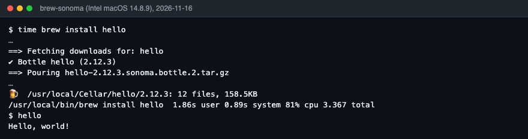

<p align="center">
  
</p>

# Intelbrew

<p>
<a href="https://intelbrew.sh"></a>


<a href="LICENSE"></a>
</p>

**Website: [intelbrew.sh](https://intelbrew.sh)**

Ready-made Homebrew packages for Intel Macs.

Homebrew no longer builds ready-made packages ("bottles") for Intel Macs, so `brew install`
falls back to compiling from source, which can take a long time. Intelbrew builds them
every day on its own Intel macOS builder. Run one command to switch, then use `brew` as normal.

## Is this for me?


- An **Intel Mac** (not Apple Silicon).
- **macOS 14 Sonoma or newer** (natively, or through OpenCore Legacy Patcher).
- **Not a Core 2 or Penryn CPU.** Most Macs from 2010-2011 on work; a few Core i3 models
  don't. The installer checks for you.
- Apple's **Command Line Tools**. If you don't have them, run `xcode-select --install`.

The installer checks all of these and stops, without changing anything, if one is
missing. The exact CPU check is in [docs/installer.md](docs/installer.md#before-it-starts).

## Install


Paste this into Terminal:

```sh
curl -fsSL https://intelbrew.sh | bash
```

If `intelbrew.sh` doesn't resolve on your network (some DNS filters block newly registered domains), use the long form below; it fetches the same script straight from GitHub:

```sh
/bin/bash -c "$(curl -fsSL https://raw.githubusercontent.com/d4rkwyng/intelbrew/main/install.sh)"
```

What you'll see:

1. If you already have Homebrew, a choice: press **Enter** to switch it in place and keep
   your installed packages.
2. A list of every change it will make. Type the word **`yes`** and press Enter to go
   ahead. Anything else stops it with nothing changed.
3. Possibly your Mac password, if it needs to create folders in `/usr/local`. Nothing
   shows on screen while you type it; that's normal.
4. A one-time download of about 1.3 GB (roughly 5-15 minutes).
5. A boxed **ACTION NEEDED** note at the end: quit Terminal and open it again. Windows
   that were already open keep the old settings until restarted (`exec $SHELL -l`).

To check it worked, in the new Terminal window:

```sh
brew config | grep GIT_REMOTE
```

Both lines should mention `d4rkwyng`. To check the core tap itself,
`git -C "$(brew --repository homebrew/core)" remote get-url origin` should print the
fork's URL. Then use `brew install` and `brew upgrade` as usual.

**Apps (`brew install --cask`)** need `brew tap homebrew/cask` once (about 620 MB). The
installer offers it (default No), or pass `--casks`; see
[below](#brew-install---cask-says-no-cask-with-this-name-exists). Everything the installer
checks and changes is in [docs/installer.md](docs/installer.md).

Want a GUI? [Tankard](https://github.com/d4rkwyng/tankard) is a native Mac app for
Homebrew: `brew install --cask d4rkwyng/tap/tankard`.

## What you get

With an Intelbrew bottle, `brew install` downloads the finished build and pours it: no
compiling. This is `hello` on our builder, poured from its Intelbrew bottle in 3.4 seconds:



<sub>Real output, trimmed; Homebrew's Tier 3 notices removed (the builder runs upstream
brew). "…" marks each cut.</sub>

Without a bottle, the same command compiles from source on your Mac. Build times on our
builder (an Intel Sonoma VM), from its daily reports:

| Formula | Build time from source |
|---|---|
| `llvm` 23.1.5 | 3 h 16 min |
| `rust` 1.100.0 | 25 min |
| `node@24` 24.22.2 | 15.5 min |
| `python@3.14` 3.14.9 | 4.3 min |

## Common questions

### `brew install --cask` says "No Cask with this name exists"

Casks leave API mode too, so tap them once: `brew tap homebrew/cask`. That's a full clone
of about 620 MB, kept current by `brew update`. The installer asks whether to do this for
you (default No; `--yes` alone skips it). To have it done unasked, pass `--casks` or set
`INTELBREW_CASKS=1`, for example (also fine later, on a Mac already set up):

```sh
INTELBREW_CASKS=1 /bin/bash -c "$(curl -fsSL https://raw.githubusercontent.com/d4rkwyng/intelbrew/main/install.sh)"
```

Intelbrew does not build or test casks:
they are upstream app downloads, each with its own macOS minimum (for example, Vivaldi
needs Ventura).

### Why is a formula building from source?


There's no Intelbrew bottle for it, yet or ever. Either it's outside the top set (see
[Coverage](#coverage)); its new version is still in the rebuild backlog; its Intel build
broke and it's held at its last working version; it was still stuck after 8 weeks and was
dropped (see [DROPPED.md](DROPPED.md)); or it can't be built on our Sonoma builder, for
example because it needs a full Xcode or a newer toolchain (currently this includes
`node`). Formulae that depend on an unbuildable one get no Intelbrew bottle either.

### How do I go back to upstream Homebrew?

Remove the three `export` lines from your shell profile, open a new terminal, and run:

```sh
git -C "$(brew --repository)" remote set-url origin https://github.com/Homebrew/brew
brew update
```

Optionally, delete the core clone: `brew untap homebrew/core`.

More questions (newer formulae, updating, existing Homebrew, switching by hand) are in
[docs/installer.md](docs/installer.md#more-questions).

## Coverage

Intelbrew bottles the top 500 formulae by installs, plus their dependencies and build
dependencies: about 880 formulae; the rest still get upstream updates daily but build from
source. **Coverage is partial right now:** bottles were first published in week 43 of
2026, and formulae whose version changes upstream need a new Intel build, so there is a
rebuild backlog that fills in over the following days and weeks.

## How it works

Homebrew made Intel macOS Tier 3 in September 2026: no more x86_64 bottles, and Intel
support removed in or after September 2027. Intelbrew rebuilds x86_64 bottles for the
most-installed formulae daily on its own Intel Sonoma builder; plain `brew` uses them.

```
upstream homebrew-core
  │ sync: upstream formulae
  ▼
intelbrew-core fork ◄─────────┐
  │ daily Actions run         │
  ▼                           │
Intel macOS 14 builder        │
  │ build, test, linkage      │
  ▼                           │
x86_64 Sonoma bottles         │
  │ publish                   │
  ▼                           │
GitHub Releases ──────────────┘
  │   bottle blocks → fork main
  ▼
pour test from the release URL
(fails: bottle pulled, pinned)
```

Intelbrew publishes a fork of homebrew-core, `intelbrew-core`: upstream's formulae plus
bottle blocks pointing at x86_64 Sonoma bottles on that fork's GitHub Releases. Homebrew
uses it in git mode with the core remote set to the fork. These three lines in your shell
profile do that:

```sh
export HOMEBREW_NO_INSTALL_FROM_API=1
export HOMEBREW_CORE_GIT_REMOTE=https://github.com/d4rkwyng/intelbrew-core
export HOMEBREW_BREW_GIT_REMOTE=https://github.com/d4rkwyng/brew
```

Homebrew itself comes from a small fork too, `d4rkwyng/brew`: each upstream release plus
one patch that swaps the Intel "Tier 3" warning for one line, `Intelbrew: bottles from
d4rkwyng/intelbrew-core`. It carries its own release tags (7.0.11 = upstream 7.0.11 plus
the patch), which `brew update` checks out as usual. It's kept current by merges, never
rebases or force-pushes.

## Costs of git mode

- A one-off full clone of homebrew-core (about 1.3 GB); Homebrew never shallow-clones core.
- `brew update` and formula loading are slower than in API mode.
- Casks need `brew tap homebrew/cask` once ([above](#brew-install---cask-says-no-cask-with-this-name-exists)).

## Licence and trademarks

The scripts and docs here are BSD-2-Clause, like Homebrew ([LICENSE](LICENSE)). Bottles are
built from upstream formulae (Intel fixes are in the fork's history) and keep each
project's own licence; for GPL/LGPL software the corresponding source is published in the
same GitHub Release as the bottle. Intelbrew is independent: not affiliated with or
endorsed by Homebrew, and not affiliated with `rhyn-daitenku/intelbrew`. Homebrew, Apple,
Mac, macOS and Intel are trademarks of their respective owners, used only to describe
compatibility.
